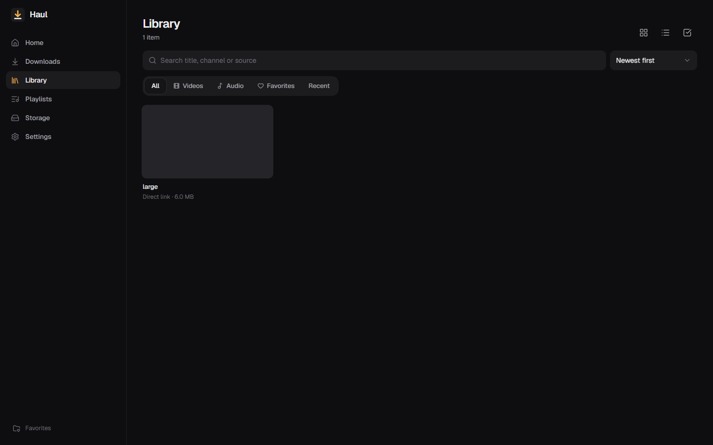
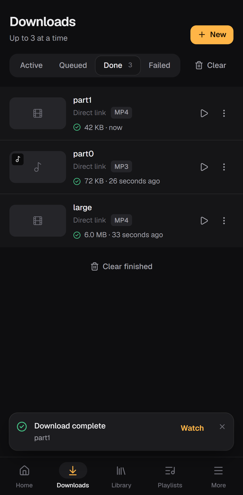

# Haul: media downloader & library

Haul is a self-hosted, installable web app (PWA) for saving video and audio from 1,700+ sites (via [yt-dlp](https://github.com/yt-dlp/yt-dlp)) into a personal library you can watch, listen to and organize from any phone, tablet or computer.

* **Paste → pick → done.** Paste or share a link. Haul identifies the source, reads the metadata and offers simple quality chips (Best · 1080p · 720p … · MP3/M4A/Opus/FLAC), with an "All formats" table for power users.
* **A real download manager.** Concurrent downloads, priority queue, pause/resume (continues partial files), cancel, retry, auto-retry on network errors, scheduling, live speed/ETA, and crash recovery.
* **Library + players in one product.** Search, sort, filter, grid/list, favorites, playlists, rename, multi-select, duplicates, storage breakdown. Custom video player (speed, PiP, subtitles, keyboard + touch gestures, resume position) and audio player (queue, shuffle, repeat, lock-screen controls).
* **No ads, no tracking.** Your server, your files.

| Desktop | Mobile |
|---|---|
|  |  |

## Quick start (Docker)

```bash
cp .env.example .env
```

```bash
docker compose up -d --build
```

Open http://localhost:8000. To install on phones you need HTTPS: set `HAUL_DOMAIN` and `HAUL_API_TOKEN` in `.env`, then run `docker compose --profile https up -d` (Caddy obtains a certificate automatically). See [docs/05-deployment.md](docs/05-deployment.md).

## Local development

Requirements: Python 3.12+, Node 20+ (Node also serves as yt-dlp's JavaScript runtime for YouTube). FFmpeg is optional: a static build is bundled via `imageio-ffmpeg` when it isn't on `PATH`.

```bash
cd backend && python -m venv .venv && .venv/Scripts/pip install -r requirements-dev.txt
```

```bash
cd backend && .venv/Scripts/python -m uvicorn app.main:app --reload --port 8000
```

```bash
cd frontend && npm install && npm run dev
```

Then open http://localhost:5173 (Vite proxies `/api` to port 8000). On macOS/Linux use `.venv/bin/` instead of `.venv/Scripts/`.

## Tests

```bash
cd backend && .venv/Scripts/python -m pytest
```

```bash
cd frontend && npm test
```

```bash
cd frontend && npx playwright install chromium && npm run test:e2e
```

* **Backend (58 tests):** URL/SSRF/path safety, error classification, format presets. Real downloads from a local media server: video, MP3/M4A/Opus extraction, pause → resume continuing partial data, failure → retry, cancel, priority scheduling, playlists, duplicates, rescan, auth, rate limiting, crash recovery. `HAUL_NETWORK_TESTS=1` adds a live YouTube test.
* **Frontend (19 tests):** formatting, selection/size-estimate logic, queue/shuffle/repeat logic, and component tests for the download row and paste/analysis flow.
* **End-to-end (6 journeys, Chrome desktop + Pixel 7 emulation):** paste → analyze → download → library → play video (shortcuts, resume position), audio extraction → mini player → playlist → search, error states, light theme, mobile layout without horizontal overflow, and PWA manifest/service worker/offline shell/share target.

## Documentation

| Doc | Contents |
|---|---|
| [01 Research](docs/01-research.md) | Competitor analysis, user complaints, positioning |
| [02 PRD](docs/02-prd.md) | Goals, personas, prioritized features, journeys, IA, acceptance criteria |
| [03 Architecture](docs/03-architecture.md) | System, engine, job lifecycle, frontend, PWA, design system |
| [04 API & database](docs/04-api.md) | REST + SSE reference, schema |
| [05 Deployment](docs/05-deployment.md) | Docker, HTTPS, bare metal, installing on each platform, Microsoft Store packaging |
| [06 Support matrix & limitations](docs/06-limitations.md) | What works where, known limitations |
| [07 Implementation report](docs/07-implementation-report.md) | What was built and how it was verified |

## Responsible use

Haul downloads only publicly accessible media and refuses DRM-protected streams. Respect copyright and each site's terms. Download content you own or have permission to keep.
